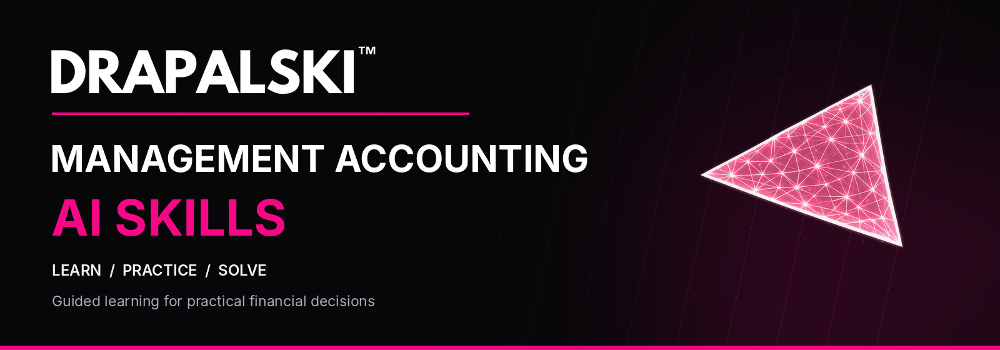
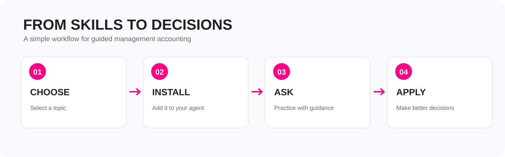
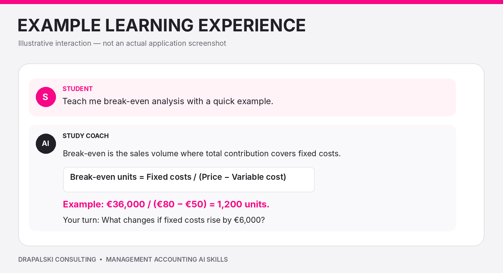

# Drapalski Consulting | Management Accounting AI Skills



**Explain complex ideas. Practice with feedback. Make better financial decisions.**

An independent **Drapalski Consulting** library of 11 reusable Agent Skills for management accounting, controlling and decision support. Each Skill gives a compatible AI assistant a focused teaching workflow, core formulas, an original worked example and fictional practice scenarios.



## Featured Article

### From Answers to Understanding: Introducing Drapalski Management Accounting AI Skills

How can AI make management accounting more interactive, accessible, and practical?

In this article, I introduce the **Drapalski Management Accounting AI Skills Library**, an open collection of 11 reusable AI Skills designed to support financial analysis, controlling, budgeting, and business decision-making.

**[Read the full article on Substack →](https://drapalski.substack.com/p/from-answers-to-understanding-introducing)**

Explore the AI Skills, follow the [installation guide](INSTALL.md), and start learning with practical exercises and interactive AI-assisted analysis.

## Install in one command

**You need:** [Node.js (LTS)](https://nodejs.org/), internet access and a **compatible AI agent** (for example Claude Code or Cursor with Agent Skills support).

```powershell
npx skills add drapalski/drapalski-management-accounting-skills -g
```

Follow the installer prompts to choose the agent and the Skills. Open the chosen agent and ask:

> Use the study-coach skill. Teach me break-even analysis with one hint at a time, then let me try a new case.

**Important:** GitHub hosts files; it does not run an AI chatbot. Installing Agent Skills does **not** automatically make them available in a normal ChatGPT browser conversation. For details and troubleshooting, see **[INSTALL.md](INSTALL.md)**.

## Explore the Skills

| Skill | Focus |
|---|---|
| [Cost concepts](skills/cost-concepts/SKILL.md) | Cost behaviour, relevance and classification |
| [Contribution & CVP](skills/cvp-decision-making/SKILL.md) | Break-even, target profit and special decisions |
| [Overhead allocation](skills/overhead-full-costing/SKILL.md) | Full cost and departmental rates |
| [Activity-based costing](skills/activity-based-costing/SKILL.md) | Activities, drivers and product profitability |
| [Budgets & forecasting](skills/budgeting-forecasting/SKILL.md) | Connected operating and cash plans |
| [Standard cost variances](skills/standard-cost-variances/SKILL.md) | Flexible baselines and reconciliation |
| [Performance measurement](skills/performance-measurement/SKILL.md) | KPIs, responsibility and incentives |
| [Working capital](skills/working-capital/SKILL.md) | Receivables, stock, payables and liquidity |
| [Strategic cost management](skills/strategic-cost-management/SKILL.md) | Cost strategy and scenario selection |
| [Decision simulator](skills/decision-simulator/SKILL.md) | Cross-functional management decisions |
| [Study coach](skills/study-coach/SKILL.md) | Hints, diagnostics, practice and feedback |

## How it helps

**Understand:** plain-language intuition and a compact formula.  
**Practice:** a fictional case with explicit assumptions and units.  
**Check:** calculation steps, reconciliations and managerial interpretation.  
**Apply:** change the assumptions and compare realistic choices.

The included scenarios use **fictional entities and newly generated figures**, not real customer or institutional datasets. The learning methods are established management accounting concepts and are not presented as newly invented theories.

## Example interaction



*Illustrative visualization, not a screenshot from a running AI application.*

## Files you might need

- **[INSTALL.md](INSTALL.md):** one-page installation and troubleshooting guide.
- **[LEARNING_PATH.md](LEARNING_PATH.md):** recommended topic sequence, independent of any timetable.
- **[BRANDING.md](BRANDING.md):** identity, colors and media use.
- **[MAINTAINERS.md](MAINTAINERS.md):** content review, validation and publishing conventions.
- **[PRACTICE_LIBRARY.md](PRACTICE_LIBRARY.md):** cross-topic synthetic challenge prompts.

## Project status and use

Published by **Drapalski Consulting**. Review output independently: AI-generated calculations and suggestions may be wrong. The package contains synthetic scenarios and does not include confidential business or personal records. Public access alone does not create an open-source reuse license; see [RIGHTS.md](RIGHTS.md).
